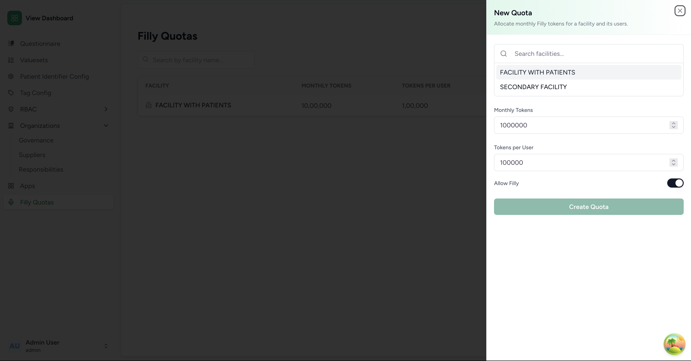
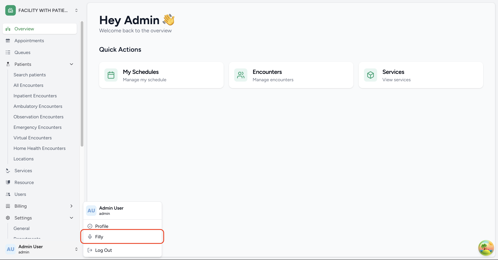
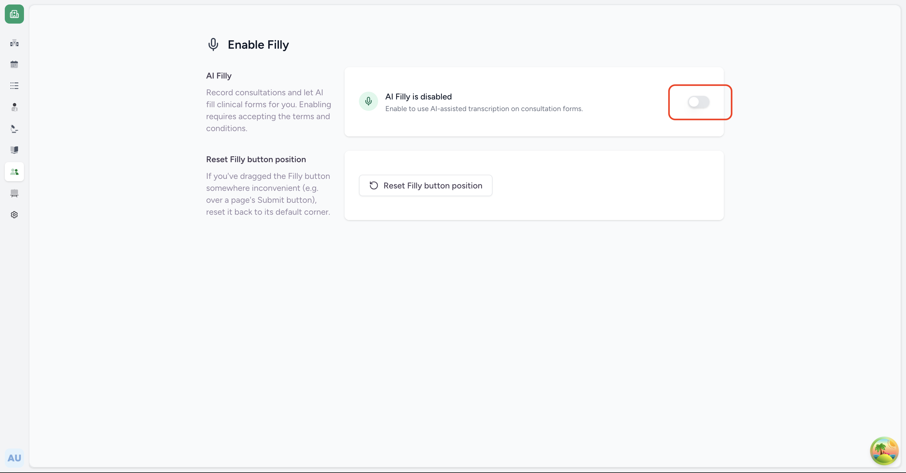
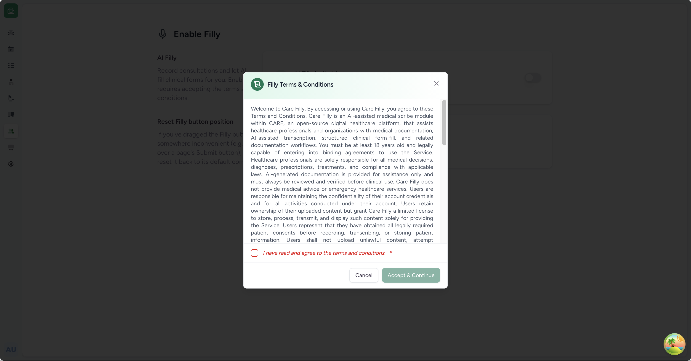

# care_filly_fe

> AI-powered clinical documentation (Filly) plugin for the [CARE](https://github.com/ohcnetwork/care_fe) EMR.

`care_filly_fe` is a **Care Frontend plugin** that brings AI **Filly** capabilities to OHCN's EMR. A clinician records a consultation, the audio is transcribed and structured by the [care_filly](https://github.com/ohcnetwork/care_filly) filly backend, and the extracted values are automatically matched and filled into CARE questionnaire forms — saving manual data entry and letting clinicians focus on the patient.

It runs as a **Vite Module Federation remote** loaded by [`care_fe`](https://github.com/ohcnetwork/care_fe) and adds a floating microphone control that records, transcribes, and auto-fills forms.

---

## What it does

-  **Record consultations** — a floating mic button captures the doctor–patient conversation; an in-house **client-side VAD** (Silero via `@ricky0123/vad-web`) segments speech into utterances that are uploaded to the backend as they finish, while recording continues.
-  **Batch transcription** — each uploaded utterance is transcribed server-side as it arrives; the plugin polls the session for the assembled transcript (there is no live/streaming transcript during recording).
- **Structured extraction** — a dynamic AI template (built from the current form's fields) instructs the model to return structured JSON (vitals, notes, etc.).
- **Auto-fill forms** — extracted values are fuzzy-matched to CARE questionnaire fields and written into the form, then highlighted and scrolled into view for clinician review.
- **Filly history** — past sessions (transcript, extracted values, audio) are stored server-side and can be re-applied or re-processed from the history panel.
- **Quotas & opt-in** — per-facility/per-user token quotas with admin management pages, and a per-user filly opt-in (with TnC consent) on the profile/settings page.

---

## How it works (in brief)

```text
care_fe (host)  ──loads remoteEntry.js──▶  manifest.ts  ──extends "Scribe(care_filly)"──▶  FillyController
                                                                                     │
                                          useFilly + template-builder ◀─────────────┘
                                                     │
                              VadRecorder + filly-api ──▶ Filly backend (care_filly)
```

1. `care_fe` loads this plugin as a federated remote and renders `FillyController` on questionnaire forms.
2. The user records a consultation; the in-house **VAD recorder** segments speech and uploads each utterance directly to the **filly backend** with the CARE JWT (no third-party SDK, no fetch shim).
3. A **dynamic template** built from the current form's fields tells the AI what JSON to return.
4. When recording stops, the plugin **polls the session** until the transcript and structured results are ready.
5. Extracted values are **fuzzy-matched** to question labels and written into CARE form responses, then **highlighted and scrolled into view** for review.

---

## Usage flow

Filly is opt-in at two levels — a facility admin must first enable it for the
facility, and each user must then individually opt in before the floating
button appears for them.

1. **Admin: enable Filly for a facility.** A superuser opens the **Filly
   Quotas** admin page (`/admin/filly/quotas`) and creates/edits a quota
   entry for the facility — setting the monthly token pool (`tokens`) and the
   per-user allowance (`tokens_per_user`), and toggling **Allow Filly** on
   for that facility.

  

2. **User: gets access once their facility has a quota.** Once their
   facility has an active quota with Allow Filly on, the user is eligible —
   they now have a monthly token allowance to use, but Filly is still hidden
   until they opt in themselves (see next step).

3. **User: enable Filly from the user menu.** From their own user menu, the
   user opens **Filly** (`/facility/:facilityId/users/:user/filly`), which
   shows the **Enable Filly** toggle.

   <!-- screenshot: user menu — "Filly" entry -->
   
   <!-- screenshot: Filly settings page — Enable Filly toggle -->
   

4. **User: accept the consent dialog.** Turning the toggle on opens a Terms
   & Conditions dialog; the preference is only saved as enabled once the
   user accepts. If the TnC text is later updated, the user is asked to
   re-consent.

   <!-- screenshot: TnC consent dialog -->
   

5. **Use it.** The floating **Filly** button now appears on questionnaire
   forms for that user. Recording, transcription, and history all work
   exactly as defillyd above.

### Moving the Filly button

The floating button can be **dragged** anywhere on screen — useful when it's
sitting on top of a page's own submit button. It snaps back to a reachable
position if dragged near a screen edge.

To reset it back to its default corner:

- **Double-click / double-tap** the button,
- **Press and hold** the button for about 2 seconds (a ring fills in
  around it while held, as a touch-friendly alternative to double-tap), or
- Use the **Reset Filly position** button on the same **Filly** settings
  page used to enable it (user menu → Filly).

---

## Getting started

### Prerequisites

- **Node.js ≥ 22.9.0**
- A running **[care_fe](https://github.com/ohcnetwork/care_fe)** instance configured to load this plugin
- The **[care_filly](https://github.com/ohcnetwork/care_filly)** CARE backend plugin — auto-detected via `window.CARE_API_URL`, served under `/api/care_filly/v1`

### Setup

```bash
# 1. Configure environment (optional — e.g. REACT_FILLY_LANGUAGES transcription hint)
cp .env.example .env

# 2. Install dependencies
npm install

# 3. Start the dev server (build:watch + preview on port 10122)
npm start
```

`npm start` runs two processes concurrently:

| Script        | What it does                                            |
| ------------- | ------------------------------------------------------- |
| `build:watch` | Nodemon watches `src/` and runs `vite build` on changes |
| `preview`     | Serves built assets on **port 10122** with CORS enabled |

> Vite bakes `REACT_*` variables in at **build time** — rebuild after editing `.env`.

## care_fe registration

Register the plugin in care_fe via the admin panel:

```json
{
  "url": "http://localhost:10122/assets/remoteEntry.js",
  "name": "care_filly_fe"
}
```

care_fe resolves the package, loads `remoteEntry.js`, and mounts `FillyController` on forms that expose the `Scribe` extension point.

---

## Project structure

```text
src/
├── manifest.ts              # Plugin manifest (routes, extends, nav items)
├── routes.tsx               # Admin quota pages + user filly settings page
├── index.tsx                # Module-federation entry + exports
├── hooks/
│   ├── useFilly.ts         # In-house recorder + backend integration
│   ├── useQuota.ts          # Facility/user quota gating
│   └── useFillyPreference.ts # Per-user filly opt-in
├── components/
│   ├── admin/               # Quota management pages (superuser)
│   └── filly/
│       ├── FillyController.tsx   # Floating widget + form auto-fill
│       ├── HistoryPanel.tsx       # Past sessions (re-apply / re-run)
│       ├── FillyProfileSection.tsx # Profile opt-in section
│       └── FillySettingsPage.tsx   # User settings page
└── lib/
    ├── filly-be.ts         # Backend URL resolution (CARE + /api/care_filly)
    ├── template-builder.ts  # Dynamic extraction prompt from form fields
    ├── quota-api.ts         # Quota / preference API client
    ├── filly-history.ts    # Server-side history API client
    ├── structured/          # Structured data matching & form fill
    └── types/filly.ts
```

---

## Scripts

- `npm start` — Build in watch mode + preview server
- `npm run build` — Production build (`vite build`)
- `npm run preview` — Serve built assets on port 10122
- `npm run lint` — Run ESLint over `src/`
- `npm run lint-fix` — Run ESLint with `--fix`
- `npm run format` — Format `src/` with Prettier
- `npm run sort-locales` — Sort `public/locale/*.json` keys

---

## Tech stack

React 19 · TypeScript · Vite · Module Federation · TailwindCSS · Radix UI · `@ricky0123/vad-web`
